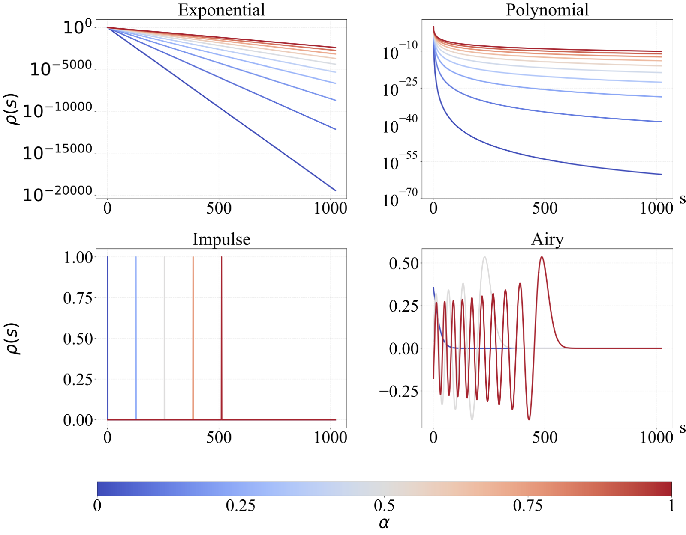

<div align="center">

# Controllable Memory Functions

**A synthetic benchmark that measures *what kinds of memory* a sequence model can learn.**

<a href="https://pytorch.org/get-started/locally/"></a>
<a href="https://lightning.ai/"></a>
<a href="https://hydra.cc/"></a>
<a href="https://github.com/miaopas/Controllable-Memory-Functions/actions/workflows/cmf.yml"></a>
<a href="LICENSE"></a>

</div>

> **Bring a model, get a comparison report.** The `cmf` tool trains your PyTorch model on
> every memory function and difficulty level, then compares it with LSTM, GRU, TCN,
> Transformer, S4D and Mamba baselines in one HTML (and PDF) report. Baseline results are
> bundled, so you only train your own model. See [Benchmark your own model](#benchmark-your-own-model).
> The full paper experiments are also here (see [Paper experiments](#paper-experiments-hydra-pipeline)).

---

## Why

Sequence models (RNNs, CNNs, Transformers, state-space models) are often
compared on downstream tasks, which mix many effects together. This project
isolates one question: **how well can a model learn a target whose dependence on
the past follows a given *memory function* ρ(s)?** We control the *shape* of the
memory (exponential, polynomial, impulse, oscillating) and its *difficulty* (how far
back it reaches), then train models of different sizes and see where each one
breaks.

## The task

Inputs $x_t$ are random sequences. Targets are a (nonlinear) convolution of the
input with a memory function $\rho$:

$$
y_t \;=\; \sigma_{\text{out}}\!\Big(\sum_{s=0}^{t} \rho(s)\,\sigma_{\text{in}}(x_{t-s})\Big)
$$

The model sees $x_{1:t}$ and must predict $y_t$ at every step (causal
sequence-to-sequence regression, MSE loss). Each memory function has a
**difficulty parameter α**: larger α means longer or harder memory.

| Memory function | ρ(s) | What α controls | Name in code |
|---|---|---|---|
| Exponential | $e^{-s/\alpha}$ | decay time-scale | `exponential` |
| Polynomial | $(1+s)^{-1/\alpha}$ | tail heaviness | `polynomial` |
| Impulse | $\mathbb{1}[s = \lfloor \alpha T/2 \rfloor]$ | delay of a single recall | `impulse` |
| Airy | $\mathrm{Ai}\big(40(s/T - \alpha/2)\big)$ | how far the oscillation reaches | `airy` |
| Prony series | $\tfrac1K\sum_k \lambda_k^{s}$ | spread of time-scales (γ, K) | `prony` |
| Mixture | $(1-\beta)\,\rho_{\exp} + \beta\,\rho_{\text{imp}}$ | mixture weight β | `mix_exp_impulse` |

<p align="center">
  
  <br><em>The four main memory functions, coloured by normalised difficulty α (blue = easy, red = hard).</em>
</p>

All memory functions are defined in [`src/data/lf/rho.py`](src/data/lf/rho.py)
and the data generator is in [`src/data/lf/generator.py`](src/data/lf/generator.py).
In the generated data the stored model input is already $u_t = \sigma_{\text{in}}(x_t)$
(with $\sigma_{\text{in}} = \sigma_{\text{out}} = \tanh$ in all suites and paper experiments).

## Models included

| Family | Models | Code |
|---|---|---|
| Recurrent | LSTM, GRU, linear / diagonal / gated RNN | `src/modules/layers/{rnn,gru,diagRNN}.py`, `torch.nn.LSTM` |
| Convolutional | TCN, dilated CNN | `src/modules/layers/tcn.py` |
| Attention | Transformer, relative-position Transformer | `src/modules/layers/{transformer,RPETransformer}.py` |
| State space | S4 / S4D, Mamba | `src/modules/layers/{s4,multi_s4,mamba}.py`; pure-PyTorch S4D and Mamba for `cmf` in [`cmf/models.py`](cmf/models.py) |
| Mixed | any two of the above stacked (e.g. `LSTM_S4`) | `configs/module/lit_module/mix_model/` |

Every model is wrapped as `Linear(1→m) → model → Linear(m→1)`, where *m* is the
model width that the sweeps vary.

## What you get

For each model, a sweep over **memory function × α × model size m × seed** gives
the minimum training/validation loss per setting. The report shows, side by side
with the baselines:

- a **memory profile**: a heatmap of the best loss per memory function and difficulty level;
- a **difficulty-sensitivity score**: how many times larger the loss is at the hardest α than at the easiest;
- **loss vs α** for each memory function: how quickly performance degrades as memory gets longer;
- **loss vs model size**: whether a bigger model fixes it;
- **key findings** in plain language, plus every number in a data table.

---

## Installation

Python 3.10 or 3.11. A CUDA GPU is strongly recommended for the full sweeps.

```bash
git clone https://github.com/miaopas/Controllable-Memory-Functions
cd Controllable-Memory-Functions
```

**Option A: Poetry (pinned versions, recommended)**

```bash
poetry install --no-root
```

Then run the commands below with `poetry run python …`.

**Option B: pip**

```bash
pip install -r requirements.txt
```

**Option C: container (HPC)**: build `apptainer1.def`. See
[`scripts/helpers.sh`](scripts/helpers.sh).

**Option D: only the benchmark tool (`cmf`)**: it needs neither Hydra, Lightning nor W&B.
This installs the `cmf` command (dependencies: torch, numpy, scipy, pandas, matplotlib, pyyaml):

```bash
pip install -e .
```

Add `".[ray]"` for the Ray backend (GPUs, clusters) and `".[test]"` for the tests.

In the paper pipeline, some models need extra compiled packages: S4 can use `pykeops` or the
CUDA kernels in `extensions/kernels/`, and Mamba needs `mamba-ssm`. The `cmf` builtins
(including S4D and Mamba) are plain PyTorch.

## Benchmark your own model

The `cmf` package (in [`cmf/`](cmf/)) trains a model on every memory function
and difficulty level of a *suite*, then compares it with baselines in a
self-contained HTML report (optionally also a PDF). It uses the paper's memory functions
and data generator, and mirrors the paper's training recipe. After `pip install -e .` the
command is `cmf`; `python -m cmf` works without installing.

**1. Write the model.** Any `torch.nn.Module` built from a width `m` that maps
`(batch, T, m) → (batch, T, m)` and is **causal**: the output at step *t* may only
use inputs up to *t*. Returning a tuple is fine (only the first element is used). The tool
adds `Linear(1→m)` before and `Linear(m→1)` after it.

```python
# examples/my_model.py
import torch
from torch import nn

class ResidualGRU(nn.Module):
    def __init__(self, width: int):
        super().__init__()
        self.rnn = nn.GRU(width, width, batch_first=True)
        self.gate = nn.Linear(width, width)

    def forward(self, x):
        h, _ = self.rnn(x)
        return x + torch.sigmoid(self.gate(x)) * h
```

**2. Check it.** This builds the model, checks the output shape, and checks causality
by perturbing the input at one time step and verifying that earlier outputs don't move:

```bash
cmf check --model examples.my_model:ResidualGRU --size-arg width
```

**3. Benchmark it.** `--size-arg` names the constructor argument that receives the width
(the default is the first positional argument); `--workers` runs trials in parallel CPU
processes:

```bash
cmf run --model examples.my_model:ResidualGRU --size-arg width --suite quick --workers 8
```

**4. Build the report** against the bundled baseline results for the same suite. The first
run directory is "your model":

```bash
cmf report runs/ResidualGRU_quick --baselines all --out reports/residual_gru.html --pdf reports/residual_gru.pdf
```

`--baselines lstm,tcn` picks specific ones. To compare with baselines trained on your own
hardware or widths, run them like any model (`cmf run --model lstm --suite quick`) and list
their run directories instead: `cmf report runs/ResidualGRU_quick runs/LSTM_quick`.

The same from Python:

```python
import cmf
from examples.my_model import ResidualGRU

if __name__ == "__main__":   # needed when workers > 1
    mine = cmf.run(ResidualGRU, name="ResidualGRU", suite="quick", workers=8)
    cmf.report([mine], out="reports/residual_gru.html", baselines="all",
               pdf="reports/residual_gru.pdf")
```

`cmf list` shows the suites, builtin models, bundled reference results and memory functions.

### Suites

| Suite | Memory functions × α levels | Widths | Seeds | T | Epochs | Trials (default widths) | Use |
|---|---|---|---|---|---|---|---|
| `smoke` | exp, impulse × 2 | 8 | 1 | 32 | 2 | 4 | does my model plug in? (seconds) |
| `quick` | exp, poly, impulse, airy × 5 | 8, 16, 32 | 2 | 256 | ≤ 30 | 120 | demo / development (laptop: about 20 min for a GRU-sized model, 1 h for TCN, with 8 workers on an M4 CPU) |
| `standard` | exp, poly, impulse, airy × 8–10 (paper grids) | 4 … 256 | 5 | 1024 (impulse 256) | ≤ 300 | 1,260 | paper setting (GPU cluster) |

A suite is a small YAML file. Copy [`cmf/suites/quick.yaml`](cmf/suites/quick.yaml)
to define your own (other functions, α grids, T or budgets) and pass its path to `--suite`.

### Builtin baselines and bundled results

| `--model` | What it is |
|---|---|
| `lstm`, `gru` | `torch.nn.LSTM` / `torch.nn.GRU`, one layer |
| `tcn` | the paper's dilated causal CNN ([`src/modules/layers/tcn.py`](src/modules/layers/tcn.py)), 8 levels |
| `transformer` | one-layer causal Transformer, sinusoidal positions |
| `s4d` | one pre-norm S4D block (diagonal state space, FFT convolution), pure PyTorch |
| `mamba` | one pre-norm Mamba block (selective state space, exact chunked scan), pure PyTorch |

Benchmark them with `--model <name>`, exactly like your own model. `s4d` and `mamba` are
compact re-implementations in [`cmf/models.py`](cmf/models.py), not the official kernels;
the pure-PyTorch Mamba scan is several times slower than an LSTM on CPU.

Results for the builtins are bundled in [`cmf/reference/`](cmf/reference/) and used by
`--baselines`: the `smoke` suite for all six, and the `quick` suite for LSTM and TCN so far
(widths 8, 16, 32; CPU). Reference results for `standard` need a GPU cluster and are not
bundled yet. If your run uses different suite settings, the report warns that the comparison
is not like-for-like.

### Outputs

Each run writes `runs/<model>_<suite>/results.csv` (one row per trial: memory
function, α, width, seed, parameter count, best train/val loss and relative loss, test
loss, epochs, wall time) and `run.json` (model, suite, environment). Interrupted runs
resume where they stopped. The headline metric is the best training relative MSE,
MSE / Var(y), as in the paper; `cmf report --metric val_rloss_min` switches to validation.
`--pdf` writes a PDF version of the report: a summary page with the key findings and the
sensitivity table, then one page per figure.

### GPUs and clusters

The `standard` suite has 1,260 trials per model, which is a job for a GPU machine or a cluster.
Two ways to split it up, both writing into the same run directory and both resumable:

- **Ray** (`pip install -e ".[ray]"`): every trial is a Ray task. On one machine,
  `cmf run --model ... --suite standard --backend ray --gpus-per-trial 0.25` packs four trials
  onto each GPU; add `--ray-address auto` to use an existing Ray cluster.
  See [`examples/cluster/ray.sh`](examples/cluster/ray.sh).
- **Array jobs** (Slurm, PBS): `--shard I/N` runs every N-th trial starting at I, so N array
  tasks cover the suite. See [`examples/cluster/slurm_array.sh`](examples/cluster/slurm_array.sh)
  and [`examples/cluster/pbs_array.pbs`](examples/cluster/pbs_array.pbs).

Then build the report from the run directory as usual.

### Tests and CI

`pytest test/test_cmf.py` runs the unit tests (about 30 s on a laptop). GitHub Actions
([`.github/workflows/cmf.yml`](.github/workflows/cmf.yml)) runs them on every push, then runs
the `smoke` suite end to end on the example model and uploads the HTML and PDF report as a
build artifact.

**Training recipe** (all models, all suites): Adam (lr 1e-3), cosine learning-rate
decay over the epoch budget, batch size 64, early stopping on the training loss, and
the minimum over seeds per setting.

## Paper experiments (Hydra pipeline)

The original research pipeline uses [Hydra](https://hydra.cc) configs, Lightning,
[Ray Tune](https://docs.ray.io/en/latest/tune/) for sweeps and W&B for logging.
Any config value can be overridden from the command line.

**Logging.** Sweeps log to [Weights & Biases](https://wandb.ai) by default. Use your own
account, and set the `entity` in [`configs/logger/wandb.yaml`](configs/logger/wandb.yaml):

```bash
export WANDB_API_KEY=<your-key>   # or: wandb login
```

**1. One training run**: an LSTM of width 16 on the exponential memory, α = 0.2,
logging to CSV instead of W&B:

```bash
python src/train.py data=lf module=lit_module/LSTM \
  data.rho_name=exponential data.rho_param.alpha=0.2 \
  callbacks.early_stopping.monitor=train/loss_epoch \
  callbacks.model_checkpoint.monitor=val/loss callbacks.model_checkpoint.mode=min \
  trainer=cpu trainer.max_epochs=5 logger=csv +skip_confirm=true
```

**2. A full sweep** over α × width × seed:

```bash
python src/train_multiple.py experiment=Dataset/LSTM/exp/coarse trainer=gpu +skip_confirm=true
```

The sweep grid is defined in the experiment file under `sweeper.param`.
When it finishes, the results are pulled from W&B into
`results/<project>_data_clean.pkl`, and a summary PDF report is written next to it.

**3. On a PBS cluster**: each line of a script in `scripts/` is one sweep:

```bash
export WANDB_API_KEY=<your-key>
./_submit_jobs.sh scripts/Dataset/LSTM.sh scripts/Dataset/S4.sh
```

Set your PBS project ID in `_run_array_jobs.pbs` first.

### Experiment catalogue

| Folder | Study |
|---|---|
| `configs/experiment/Dataset/<Model>/<function>/coarse.yaml` | main study: single-layer model, α × width × seed |
| `…/<function>/multi_layer*.yaml` | the same with deeper models |
| `configs/experiment/Dataset/<Model>/{prony_K,prony_gamma,mix_target}/` | Prony-series and mixture targets |
| `configs/experiment/Mixed_Models/<A>_<B>/` | two-layer hybrids (e.g. LSTM → S4) |
| `scripts/Dataset_length_ablation/` | sequence-length ablation (T = 64 … 2048) |

### Adding a model to the paper pipeline

For the full Ray/W&B sweeps (instead of `cmf`), adding a model takes four small
steps. Use LSTM as the template.

**1. Write the layer.** Input and output have shape `(batch, T, m)`, and it must be
**causal**: the output at *t* may only use inputs up to *t*. Accept `**kwargs` in
`forward`. Returning a tuple is fine; only the first element is used.

```python
# src/modules/layers/my_model.py
import torch.nn as nn

class MyModel(nn.Module):
    def __init__(self, d_model: int = 16):
        super().__init__()
        self.rnn = nn.GRU(d_model, d_model, batch_first=True)

    def forward(self, x, **kwargs):
        return self.rnn(x)[0]
```

**2. Add a layer config** `configs/module/layers/MyModel.yaml`:

```yaml
_target_: src.modules.layers.my_model.MyModel
d_model: 16
```

**3. Add a module config** `configs/module/lit_module/MyModel.yaml`. Copy
`LSTM.yaml` and replace the `LSTM` layer with `MyModel`, wiring `Input.output_size`,
`MyModel.d_model` and `Output.input_size` to the same width.

**4. Add experiment configs.** Copy `configs/experiment/Dataset/LSTM/` to
`configs/experiment/Dataset/MyModel/`. Set `override /module: lit_module/MyModel`
in `base.yaml`, and in each `<function>/coarse.yaml` change the swept width key to
`module.layers.MyModel.d_model` and update the W&B `project` name. Then run:

```bash
python src/train_multiple.py experiment=Dataset/MyModel/exp/coarse trainer=gpu +skip_confirm=true
```

To get the automatic PDF report and reuse the `paper_plots/` scripts, register the
width key (`'MyModel': 'module.layers.MyModel.d_model'`) in both
[`src/utils/model_registry.py`](src/utils/model_registry.py) and
[`paper_plots/model_registry.py`](paper_plots/model_registry.py).

## Reproducing the paper figures

`paper_plots/<n>_<study>/` holds one folder per figure group, each with a
`generate_*.py` script and the resulting PDFs. The scripts read processed sweep
data (`results/*_data_clean.pkl`), which is **not included** in this repository
because of its size. To regenerate it, run the corresponding sweeps and export
them from W&B (see `notebooks/Dataset/step1/get_data.py`).

## Repository layout

```
├── cmf/                    benchmark tool: bring a model → HTML/PDF comparison report
│   ├── suites/               smoke.yaml, quick.yaml, standard.yaml
│   ├── reference/            bundled baseline results (<suite>/<model>/results.csv)
│   ├── spec.py               model contract, wrapper, causality check
│   ├── builtins.py, models.py            baselines (incl. pure-PyTorch S4D and Mamba)
│   ├── runner.py, training.py, data.py   local (parallel / sharded) runner
│   ├── ray_backend.py        Ray tasks for GPUs and clusters
│   └── analysis.py, reporting.py         scores, findings, HTML and PDF report
├── examples/               my_model.py ("bring your own model"); cluster/ (Slurm, PBS, Ray)
├── configs/                Hydra configs
│   ├── data/                 lf.yaml: the memory-function dataset
│   ├── module/               layers/, lit_module/ (model + optimiser), model/
│   ├── experiment/           sweep definitions (Dataset/, Mixed_Models/, Train/)
│   ├── trainer/ logger/ callbacks/ paths/ hydra/ …
│   ├── train.yaml            single run
│   └── train_multiple.yaml   Ray Tune sweep
├── src/
│   ├── data/lf/              rho.py (memory functions), generator.py (data), lf_datamodule.py
│   ├── modules/              layers/ (all models), models/sequential.py, lit_module.py
│   ├── utils/                Hydra helpers, result_processing.py (W&B → results + PDF)
│   ├── train.py              single-run entry point
│   └── train_multiple.py     sweep entry point
├── scripts/                job lists for cluster submission
├── paper_plots/            figure scripts and PDFs from the paper
├── notebooks/              exploratory analysis
├── test/                   tests (test_cmf.py: pytest test/test_cmf.py)
├── .github/workflows/      CI: cmf tests + smoke suite
├── extensions/kernels/     optional CUDA kernels for S4 (Cauchy / Vandermonde)
├── _submit_jobs.sh, _run_array_jobs.pbs   PBS array-job helpers
└── apptainer1.def          container definition
```

## Roadmap

1. **Done:** the `cmf` tool: model contract with a causality check, `smoke` / `quick` /
   `standard` suites, parallel local, sharded (Slurm/PBS) and Ray runners, HTML and PDF
   comparison reports with plain-language findings, builtin baselines including S4D and
   Mamba with bundled reference results, a pip-installable `cmf` command, and CI.
2. **Next:** reference results for the `standard` suite (from a GPU cluster), and
   interactive charts in the report.
3. **Later:** user-defined memory functions from the command line, per-model learning-rate
   search, multi-layer and hybrid suites, and W&B / TensorBoard export.

Contributions and issues are welcome.

## Citation

If you use this benchmark, please cite the accompanying paper:

> Jiang, H., Bao, Z., Wang, S., Li, Q. (2026). Numerical Investigation of Sequence Modeling
> Theory using Controllable Memory Functions. *Journal of Machine Learning*. Online First.
> [doi:10.4208/jml.251216](https://doi.org/10.4208/jml.251216)

```bibtex
@article{jiang2026numerical,
  title   = {Numerical Investigation of Sequence Modeling Theory using Controllable Memory Functions},
  author  = {Jiang, H. and Bao, Z. and Wang, S. and Li, Q.},
  journal = {Journal of Machine Learning},
  year    = {2026},
  note    = {Online First},
  doi     = {10.4208/jml.251216}
}
```

## License

Released under the [MIT License](LICENSE). `src/modules/layers/s4.py` and
`extensions/kernels/` are adapted from
[state-spaces/s4](https://github.com/state-spaces/s4) (Apache-2.0);
`extensions/kernels/map.h` keeps its original notice. The project layout is based on
[lightning-hydra-template](https://github.com/ashleve/lightning-hydra-template).
